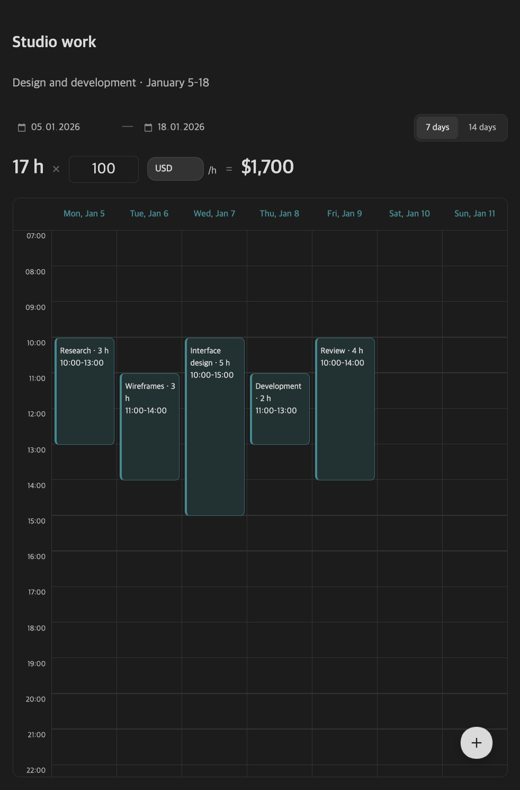

# Worklogger for Obsidian

[Русский](README.ru.md)

A small, editable timesheet inside your notes. Drag to record an interval, adjust its length, and see **hours × hourly rate = cost**. Your worklog is JSON in the same Markdown document.




## Features

- Draw, move, and resize work intervals; edit their title and description.
- Fixed start/end dates, with a compact 7- or 14-day column layout.
- Overlapping intervals count once, within the configured period (both dates inclusive).
- Hourly rate and currency per worklog. Supported currencies: RUB, USD, EUR, GBP, CNY, KZT, GEL, TRY, AED, UAH, JPY.
- English and Russian UI, or automatic language selection.
- Place `{.Time}`, `{.Rate}`, and `{.Cost}` in the same note to show its calculated totals in Reading view.
- No account, telemetry, external service, or currency conversion.

This release supports **desktop Obsidian 1.8.7 or later**. Mobile interaction has not been verified and the plugin is marked desktop-only.

## Install

Worklogger is not currently listed in the Obsidian community plugin directory.

### Manual installation

1. Download `main.js`, `manifest.json`, and `styles.css` from a [release](https://github.com/gertyhiler/obsidian-worklogger/releases).
2. Create `<your vault>/.obsidian/plugins/worklogger/` and place all three files there.
3. Reload Obsidian and enable **Worklogger** under Settings → Community plugins.

### BRAT

With [BRAT](https://github.com/TfTHacker/obsidian42-brat) installed, add `https://github.com/gertyhiler/obsidian-worklogger` as a beta plugin repository, then enable Worklogger. A published release with the three plugin assets is required.

## Use

Run the **Worklogger: Insert worklog calendar** command (its label follows the UI language), or paste this block into a note. Switch to Reading view to interact with it.

````markdown
```worklogger
{
  "id": "example-worklog",
  "version": 1,
  "start": "2026-01-05",
  "end": "2026-01-18",
  "days": 14,
  "hourlyRate": 100,
  "currency": "USD",
  "events": [
    {
      "id": "example-1",
      "title": "Design exploration",
      "description": "Compare two layout ideas",
      "date": "2026-01-05",
      "start": 600,
      "end": 780
    }
  ]
}
```

Total: {.Time} × {.Rate} = {.Cost}
````

Times are minutes after midnight: `600` is 10:00; `1440` is 24:00. Entries use local calendar dates. An interval belongs to one date; split overnight work at midnight. The example totals 3 hours and USD 300.

Drag an empty area to create a block, drag a block to move it, or drag its edge to resize it. Click a block or use the floating **+** button to open the editor. Changes are saved to the original fenced block. The 7/14 selector controls visible column width; it does not change the reporting period.

Tokens are scoped to their Markdown document and render in Reading view; the Markdown source retains the literal tokens. Use one worklog block per note for unambiguous totals. Worklogger does not resolve tokens in exported Markdown or external editors.

Choose the UI language and default currency in Settings → Worklogger. Existing worklogs retain their currency. Changing a worklog's currency changes its denomination; it **does not convert** its rate or calculate exchange rates.

## Data and privacy

Intervals, the reporting period, rate, and currency remain in the note. Plugin preferences are saved separately in Obsidian's local plugin `data.json`. Back up or sync your notes as usual; Worklogger does not provide its own backup or sync service. Avoid editing the same note concurrently on multiple devices.

All examples in this repository are synthetic. Never include private vault content when opening an issue.

## Development

Requires Node.js 22 or newer and npm.

```sh
npm ci
npm run check
npm run build
```

Copy the generated `main.js`, `manifest.json`, and `styles.css` into a test vault's `.obsidian/plugins/worklogger/`. Use a disposable test note before testing with real worklogs.

See [CONTRIBUTING.md](CONTRIBUTING.md), [SECURITY.md](SECURITY.md), and the [design decision](docs/adr/0001-inline-worklogs.md). Releases use version tags without a `v` prefix, for example `1.0.0`. The release workflow checks matching package, manifest, and compatibility versions and uploads the three plugin assets.

## License

[MIT](LICENSE) © 2026 gertyhiler.
